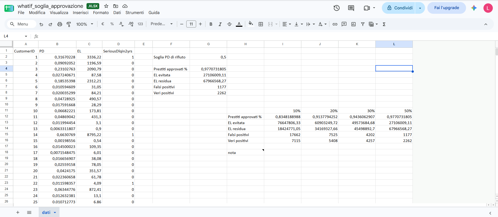
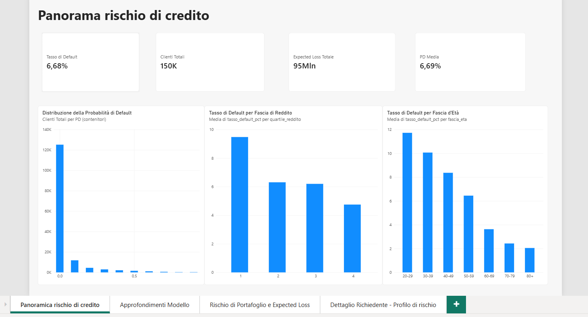
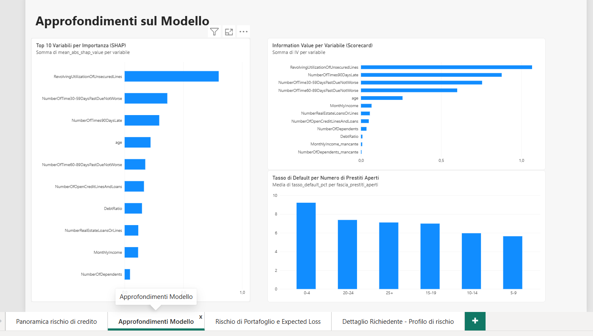
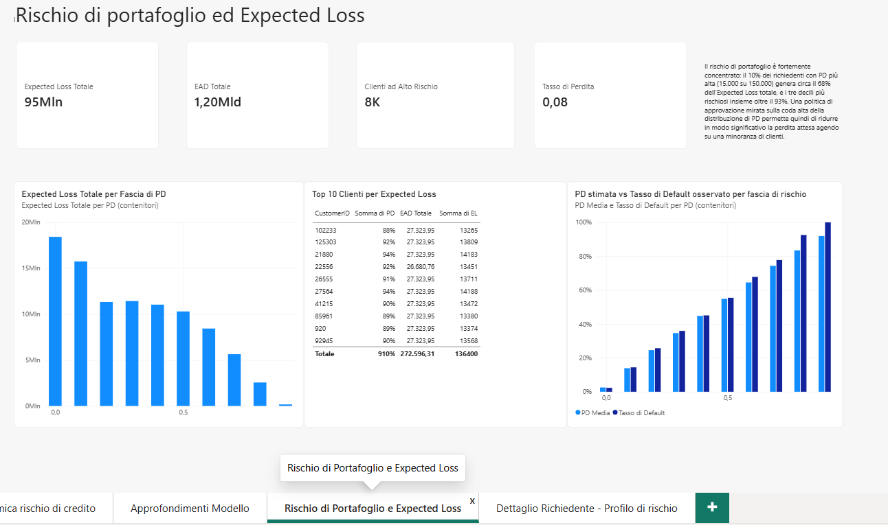
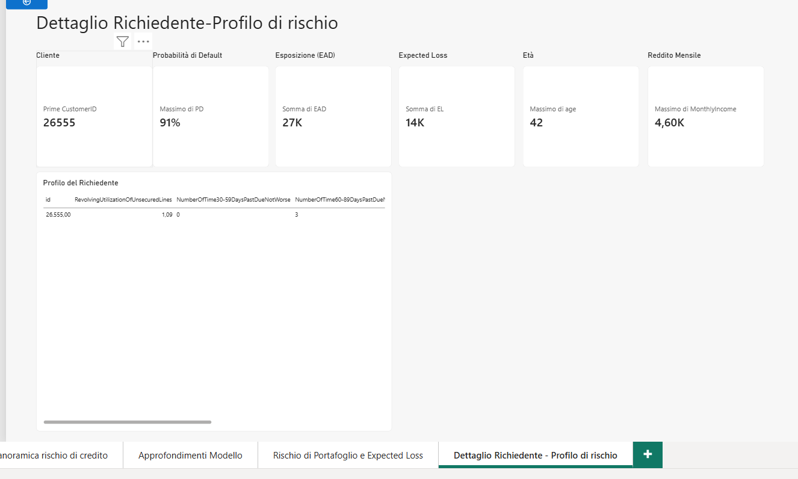

# 💳 Rischio di Credito — dalla Probabilità di Default alla Perdita Attesa

*Un'analisi end-to-end su 150.000 richiedenti di credito: chi rischia di andare in grave insolvenza, perché, quanto costerebbe alla banca e dove conviene fissare la soglia di approvazione.*

---

## 📌 Obiettivo

Una banca che concede credito al consumo deve rispondere a tre domande, e non bastano tre modelli separati: serve una storia coerente.

1. **Chi ha una probabilità alta di andare in grave insolvenza entro due anni, e per quali motivi?**
2. **Quanto ci costerebbe, e in quali clienti si concentra la perdita?**
3. **Dove conviene fissare la soglia oltre la quale si rifiuta un prestito?**

Il progetto risponde a tutte e tre partendo dallo stesso dataset, con strumenti diversi per ogni fase: SQL per le prime evidenze, statistica inferenziale e modelli predittivi in Python, una scorecard in stile bancario, simulazioni in foglio di calcolo e una dashboard Power BI a quattro pagine.

## 🗂️ Dataset

- **Fonte**: [Give Me Some Credit](https://www.kaggle.com/c/GiveMeSomeCredit), competizione Kaggle del 2011 (Credit Fusion). Il dataset **non è incluso** nel repository: le istruzioni per scaricarlo sono nella sezione *Come riprodurre il progetto*
- **Dimensione**: 150.000 richiedenti → **149.999** dopo la pulizia; 10 variabili predittive più la variabile target `SeriousDlqin2yrs` (grave insolvenza, 90+ giorni di ritardo, entro due anni)
- **Classi sbilanciate**: **6,68%** di insolventi (10.026 casi). Per questo l'accuracy da sola non dice nulla: un modello che predice sempre "nessun default" avrebbe ragione al 93%
- **Variabili**: utilizzo delle linee di credito revolving, età, reddito mensile, rapporto debito/reddito, numero di ritardi a 30-59, 60-89 e 90+ giorni, prestiti aperti, mutui, persone a carico
- **Valuta**: il dataset non indica la valuta degli importi. Trattandosi di una fonte statunitense, in tutto il progetto si assume il dollaro USA ($) per reddito, EAD ed Expected Loss

## 🛠️ Stack Tecnologico

| Strumento | Ruolo |
|---|---|
| **Python 3.14** (pandas, scipy, statsmodels, scikit-learn, XGBoost, SHAP) | Pulizia, test statistici, modelli, interpretabilità, Expected Loss, scorecard |
| **SQL Server** | Database `CreditRiskAnalysis`, query esplorative sul tasso di default per segmento |
| **Excel / Google Sheets** | Simulazione what-if sulla soglia di approvazione, calcolatore di punteggio |
| **Power BI** | Dashboard a 4 pagine con drill-through sul singolo richiedente |

## 🔍 Metodologia

### 1. Pulizia ed EDA
- **Mancanti**: `MonthlyIncome` 29.731 valori (19,82%) imputati con la mediana per fascia d'età; `NumberOfDependents` 3.924 (2,62%) imputati con 0. Entrambi hanno un flag che segnala dove l'imputazione è avvenuta
- **Età = 0**: 1 riga, rimossa (errore di inserimento)
- **Codici sentinella 96/98** nelle tre colonne dei ritardi: 269 righe (le stesse su tutte e tre). Non sono ritardi reali, ma quelle righe hanno un tasso di default di circa 54,6% contro 6,6% del resto, quindi eliminarle avrebbe tolto segnale. Ho ridotto i valori al massimo realistico di ogni colonna e creato il flag `flag_delinquenza_anomala`
- **Winsorizzazione al 99° percentile** per `RevolvingUtilizationOfUnsecuredLines` (tetto 1,093) e `DebtRatio` (tetto 4.979,08): 1.500 righe modificate ciascuna. Oltre il 94% dei valori estremi di `DebtRatio` coincide con reddito mancante o nullo: il rapporto esplode perché il denominatore è vicino a zero

### 2. SQL Server: prime evidenze
Caricamento in `CreditRiskAnalysis` e tre query sul tasso di default per **quartile di reddito**, **fascia d'età** e **numero di prestiti aperti**, esportate per la dashboard.

### 3. Test d'ipotesi con correzione per confronti multipli
Insolventi contro non insolventi su cinque variabili, con Welch o Mann-Whitney secondo la distribuzione, intervalli di confidenza e correzione di Benjamini-Hochberg. Con 150.000 righe quasi tutto è "significativo", quindi conta la **dimensione dell'effetto**:

| Variabile | Test | Effect size | Lettura |
|---|---|---|---|
| Utilizzo credito revolving | Mann-Whitney | r = 0,56 | **grande** |
| Età | Welch | d = −0,47 | piccolo (chi va in default ha circa 7 anni in meno) |
| Reddito mensile | Mann-Whitney | r = −0,15 | piccolo |
| Prestiti aperti | Mann-Whitney | r = −0,09 | trascurabile |
| Rapporto debito/reddito | Mann-Whitney | r = 0,05 | trascurabile |

### 4. Regressione logistica
VIF massimo 4,48, calcolato sui 13 predittori candidati: è quello del flag delle righe sentinella, poi escluso dal modello. Nessuna multicollinearità problematica. Modello stimato con `statsmodels` per avere p-value e intervalli di confidenza, e letto in **odds ratio**:

- Utilizzo del credito revolving: **OR = 10,18** [9,45 – 10,96]
- Ritardi 30-59 giorni: OR = 1,41 [1,37 – 1,44] per ogni evento
- Ritardi 90+ giorni: OR = 1,36 [1,32 – 1,40] per ogni evento
- Età: OR = 0,985 [0,983 – 0,987] per ogni anno

**AUC sul test set: 0,8431**, pseudo R² di McFadden 0,1929. Con soglia 0,5 la classe positiva ha precision 0,6254 ma recall solo 0,0883 (F1 0,1547): il modello è prudente e intercetta pochi insolventi a quella soglia.

Il flag è stato escluso perché le 269 righe con flag=1 hanno tutte la stessa combinazione di ritardi cappati (13, 11, 17): il flag non varia mai da solo, e il suo coefficiente (≈ −21,6) non si legge "a parità delle altre variabili" ma compensa i circa +23,8 punti di logit dati dai ritardi cappati (netto +2,2, coerente con il 54,6% osservato). Senza il flag il modello logistico sovrastima la PD di quelle righe; le PD usate per Expected Loss e what-if vengono da XGBoost.

### 5. Confronto tra modelli
Stesso split, validazione incrociata a 5 fold sul training per i due modelli nuovi:

| Modello | AUC (CV) | AUC (test) |
|---|---|---|
| Regressione logistica | — (valutata solo sul test set) | 0,8431 |
| Random Forest | 0,8570 ± 0,0039 | 0,8618 |
| **XGBoost** | 0,8631 ± 0,0056 | **0,8686** |

XGBoost guadagna circa 2,5 punti di AUC sulla regressione logistica. In ambito creditizio la spiegabilità spesso è un requisito: per questo il passo successivo è SHAP, e la scorecard resta come alternativa trasparente.

### 6. Interpretabilità con SHAP
Importanza globale (media del valore assoluto): 1) utilizzo revolving **0,80**; 2) ritardi 30-59 giorni 0,36; 3) ritardi 90+ giorni 0,29; 4) età 0,22; 5) ritardi 60-89 giorni 0,18. Tre casi locali:
- **Vero positivo** (cliente 22556, PD 91,7%): ritardi multipli gravi e utilizzo revolving oltre il 100%
- **Vero negativo** (cliente 90201, PD 0,09%): 94 anni, utilizzo e debt ratio nulli
- **Falso negativo** (cliente 32517, PD 0,16%, ma insolvente): 75 anni, utilizzo 0,4%, nessun ritardo. Profilo indistinguibile da uno a basso rischio: un limite strutturale su eventi improvvisi senza storico

### 7. Expected Loss
**EL = PD × LGD × EAD**. Il dataset non contiene importi dei prestiti, quindi LGD ed EAD sono **assunzioni dichiarate**, non dati osservati:
- **EAD** = utilizzo revolving × 25.000 $ di linea massima ipotizzata. Ho scartato la seconda opzione (reddito × debt ratio) perché dava esposizioni implicite fino a 31 milioni
- **LGD** = 55% (range di letteratura 45-75%), con sensitività su 40% e 70%

| LGD | Expected Loss totale |
|---|---|
| 40% | 69,1 M$ |
| **55%** | **95,1 M$** |
| 70% | 121,0 M$ |

EAD totale: 1,20 miliardi di $. Il rapporto EL/EAD è circa 7,9%.

### 8. Scorecard con Weight of Evidence e Information Value
Variabili in fasce, WOE per ogni fascia, IV per variabile. **Selezionate le 5 con IV ≥ 0,1**: utilizzo revolving (1,07), ritardi 90+ (0,88), ritardi 30-59 (0,76), ritardi 60-89 (0,60), età (0,26). Le altre sono deboli o non predittive (reddito 0,07, debt ratio 0,009). Regressione logistica sui WOE e conversione in punti: base 600 a odds 50:1, PDO 20 → punteggi da **418,7 a 619,1** (media 581,8, mediana 592).

### 9. What-if e calcolatore (foglio di calcolo)
Costruiti a mano, con formule. Il what-if confronta quattro soglie di rifiuto sulla PD del modello:

| Soglia PD | Approvati | EL evitata | EL residua | Buoni rifiutati | Insolventi rifiutati |
|---|---|---|---|---|---|
| 10% | 83,5% | 76,6 M$ | 18,4 M$ | 17.662 | 7.115 |
| 20% | 91,4% | 60,9 M$ | 34,2 M$ | 7.525 | 5.408 |
| **30%** | **94,4%** | **49,6 M$** | **45,5 M$** | **4.202** | **4.257** |
| 50% | 97,7% | 27,1 M$ | 68,0 M$ | 1.177 | 2.262 |

Dal 30% in su si rifiutano più insolventi che clienti buoni: sotto quella soglia il costo in volume cresce più in fretta del rischio evitato.



Il file del what-if **non è nel repository** perché contiene una riga per ogni cliente del dataset (PD, Expected Loss ed esito reale). Si ricostruisce unendo per `CustomerID` i file `probabilita_insolvenza.csv` (notebook 04) ed `expected_loss_per_cliente.csv` (notebook 06), e applicando alla soglia scelta le formule `COUNTIF`, `SUMIF` e `COUNTIFS`.

Il calcolatore, `excel/scorecard_calcolatore.xlsx`, è incluso. Parte dalla tabella dei punti per fascia che il notebook 07 esporta in `excel/scorecard_data.xlsx` (rigenerata a ogni esecuzione, quindi non inclusa) e aggiunge un foglio che somma i punti di un richiedente e li converte in probabilità di default.

### 10. Dashboard Power BI (4 pagine)
Il file `.pbix` non è nel repository perché il suo modello dati contiene il dataset Kaggle. Le quattro pagine:

- **Panoramica rischio di credito**: KPI di portafoglio, distribuzione della PD, tasso di default per reddito (dal 9,48% del primo quartile al 4,75% dell'ultimo) ed età



- **Approfondimenti Modello**: top 10 variabili SHAP, tasso di default per numero di prestiti aperti, Information Value per variabile



- **Rischio di Portafoglio e Expected Loss**: Expected Loss, EAD, tasso di perdita, clienti con PD > 30%, EL per fascia di PD, top 10 clienti per EL, PD stimata contro tasso osservato



- **Dettaglio Richiedente - Profilo di rischio**: pagina con **drill-through**, dal singolo cliente al suo profilo di rischio completo



## 🐛 Sfide tecniche e come le ho risolte

**Il separatore decimale, tre volte.** Importando i CSV in Power BI con impostazioni regionali italiane, il punto decimale veniva scartato: un tasso di default del 9,48% compariva come 948, il reddito massimo come 30 milioni invece di 3. Ho escluso un errore nel dato interrogando direttamente il database (la query restituiva 6,68, non 668) e verificando a mano il calcolo (3.554 insolventi su 37.500 = 9,48%). La correzione è forzare in Power Query il tipo Numero decimale con locale "Inglese (Stati Uniti)", colonna per colonna, anche sulle tabelle collegate.

**Quando togliere un passaggio peggiora le cose.** Eliminando lo step "Tipo di colonna modificato", tutte le colonne sono tornate Testo. I sintomi erano due numeri apparentemente plausibili: un'età massima di **99 invece di 109** e un reddito massimo di **9.999 invece di 3 milioni**. Con valori di testo, infatti, il massimo viene calcolato in ordine alfabetico ("99" viene dopo "109"). Li ho riconosciuti proprio perché dicevano il falso in modo troppo tondo, e ho ricostruito i tipi colonna per colonna.

**Un grafico corretto che non dice nulla.** Avevo costruito il "tasso di perdita per fascia di PD" (EL ÷ EAD). Con LGD costante quel rapporto è per costruzione PD × LGD, quindi il grafico mostrava solo l'assunzione fatta, come una retta. L'ho sostituito con il confronto tra PD stimata e tasso di default osservato per fascia.

**Fasce a larghezza fissa non sono decili.** Il grafico dell'Expected Loss per fascia di PD è dominato dalle fasce basse, perché lì ci sono quasi tutti i clienti. La concentrazione vera si vede ordinando i clienti per rischio: il decile più rischioso (15.000 richiedenti) genera il **67,96%** dell'Expected Loss totale, i due peggiori l'85,2%, i tre peggiori il 93,4%.

## 📊 Risultati principali

- **L'utilizzo del credito revolving domina in ogni analisi**: effect size grande (r = 0,56), odds ratio ≈ 10, primo posto in SHAP (0,80) e in Information Value (1,07)
- Il rischio cala con età e reddito: **dall'11,73% tra i 20-29 anni (l'età minima nel dataset è 21 anni) al 2,05% da 80 anni in su**, e dal 9,48% al 4,75% passando dal primo all'ultimo quartile di reddito
- **XGBoost 0,8686 di AUC** contro 0,8431 della regressione logistica: guadagno reale ma modesto
- Expected Loss del portafoglio: **95,1 M$** su 1,20 miliardi di $ di esposizione (LGD 55%), con un intervallo di 69-121 M$ al variare dell'LGD
- Il **10% più rischioso dei richiedenti genera quasi il 68% della perdita attesa**
- Rifiutare chi ha PD ≥ 30% (il 5,6% dei richiedenti) evita circa il **52% dell'Expected Loss**

## 💡 Conclusioni e raccomandazioni

1. **Usare l'utilizzo del credito revolving come indicatore di allerta**: è il segnale più forte e il più facile da monitorare nel tempo, anche prima di un ritardo di pagamento
2. **Decidere per fasce di rischio, non con un unico taglio a 0,5**: a quella soglia la regressione logistica intercetta meno del 9% degli insolventi. Una soglia intorno al 30% appare il miglior compromesso nel what-if, ma va scelta in base al costo relativo di un buon cliente perso contro un default non intercettato
3. **Concentrare il controllo sulla coda alta**: poiché una piccola quota di richiedenti genera la gran parte della perdita attesa, istruttorie più approfondite sui decili superiori sono più efficaci di regole uniformi
4. **Tenere insieme modello e trasparenza**: XGBoost per la capacità predittiva, SHAP per spiegare la singola decisione, scorecard per una regola leggibile da un responsabile crediti
5. **Calibrare LGD ed EAD sui dati storici della banca** prima di usare l'Expected Loss in modo operativo

## ⚠️ Limiti e sviluppi futuri

- **PD calcolate su tutto il dataset, training compreso**: la concordanza con il tasso osservato e le metriche del what-if sono ottimistiche. La validazione vera è l'AUC sul test set
- **LGD ed EAD sono assunzioni**. In più, l'EAD usa l'utilizzo del credito, che è anche la variabile più predittiva di PD: la concentrazione dell'Expected Loss sui clienti rischiosi è in parte costruita dal proxy. L'EAD arriva a circa 27.300 $ (oltre la linea assunta di 25.000 $) perché l'utilizzo oltre il 100% è stato mantenuto fino al tetto di 1,093
- **Quattro variabili hanno IV superiore a 0,5**, soglia che la scala standard classifica come "sospetta". Per i ritardi a 30-59 e 60-89 giorni la documentazione della fonte indica una finestra di due anni. Per `NumberOfTimes90DaysLate` non ne indica nessuna, e il target è definito proprio come 90+ giorni di ritardo: non è chiaro se quel conteggio preceda il periodo del target, quindi il suo IV (0,88) va letto con cautela
- **Recall bassa a soglia 0,5** e limite strutturale sui default improvvisi senza storico (caso del falso negativo analizzato con SHAP)
- **Reddito**: nessun tetto applicato, resta un valore massimo di 3.008.750 $ e quasi il 20% delle righe ha reddito imputato
- Dati del 2011 di una singola fonte: non rappresentano un portafoglio attuale né il ciclo economico
- **Sviluppi**: calibrazione delle probabilità, soglia scelta con una matrice di costi esplicita, validazione temporale se fossero disponibili date

## 🚀 Come riprodurre il progetto

**Requisiti**: Python 3.14 (le versioni delle librerie sono in `requirements.txt`), Jupyter o VS Code per i notebook, un account Kaggle. SQL Server con ODBC Driver 17 serve solo per il passo facoltativo 3b.

### 1. Clonare il repository e installare le dipendenze

```bash
git clone https://github.com/luigipomata/credit-risk-analysis.git
cd credit-risk-analysis
python -m venv .venv
.venv\Scripts\activate          # Windows; su macOS/Linux: source .venv/bin/activate
pip install -r requirements.txt
```

### 2. Scaricare i dati da Kaggle

1. Accedi a Kaggle e apri la [pagina della competizione](https://www.kaggle.com/c/GiveMeSomeCredit). Per scaricare i dati devi accettare le regole della competizione
2. Scarica i dati in uno dei due modi:
   - **dal sito**: scheda *Data* → *Download All*, poi estrai dall'archivio il solo file `cs-training.csv`
   - **da riga di comando**, con la [Kaggle API](https://github.com/Kaggle/kaggle-api) (serve il token `kaggle.json` in `~/.kaggle/`, su Windows in `%USERPROFILE%\.kaggle\`):
     ```bash
     pip install kaggle
     kaggle competitions download -c GiveMeSomeCredit -p data/raw
     tar -xf data/raw/GiveMeSomeCredit.zip -C data/raw cs-training.csv     # Windows 10+, macOS
     # su Linux: unzip data/raw/GiveMeSomeCredit.zip cs-training.csv -d data/raw
     ```
3. Il file deve trovarsi in **`data/raw/cs-training.csv`** (150.000 righe, circa 7,6 MB). Gli altri file della competizione (`cs-test.csv`, che non ha la variabile target, e `sampleEntry.csv`) non servono

Il `.gitignore` esclude `data/raw/`, i file per cliente in `data/processed/` e `kaggle.json`, così i dati non finiscono mai in un commit.

### 3. Eseguire l'analisi, in quest'ordine

I notebook ricavano la radice del progetto dalla propria cartella: aprili da Jupyter o VS Code, così che la cartella di lavoro sia quella del notebook.

a. **`notebooks/01_eda/01_eda.ipynb`**: pulizia del dataset, crea `data/processed/cs-training-clean.csv`

b. **Facoltativo, SQL Server**: copia `.env.example` in `.env`, inserisci i parametri del tuo server e lancia
   ```bash
   python sql/import_credit_data.py
   python sql/export_analysis_results.py
   ```
   Il primo script carica il dataset pulito in `CreditRiskAnalysis`, il secondo rigenera i tre CSV aggregati per fascia di reddito, età e prestiti aperti. Quei CSV sono già nel repository, quindi senza SQL Server si può passare al punto c

c. **Notebook da `02_analisi_statistica` a `07_scorecard`, in ordine**. Il notebook 04 sovrascrive `probabilita_insolvenza.csv`, creato dal 03, con le PD di XGBoost usate da SHAP, Expected Loss e what-if: se riesegui il 03, riesegui anche i successivi

> **Attenzione ai decimali**: i CSV usano il punto come separatore decimale. Importandoli in Power BI o Excel con impostazioni regionali italiane, imposta il locale "Inglese (Stati Uniti)" per le colonne numeriche, altrimenti i valori risultano moltiplicati.

## 📁 Struttura del repository

```
├── data/
│   ├── raw/                        # cs-training.csv, da scaricare da Kaggle (non incluso)
│   └── processed/                  # 5 CSV aggregati inclusi; i file per cliente li creano i notebook
├── docs/
│   └── img/                        # screenshot della dashboard e del what-if
├── excel/
│   └── scorecard_calcolatore.xlsx  # tabella punti della scorecard e calcolatore del punteggio
├── notebooks/
│   ├── 01_eda/
│   ├── 02_analisi_statistica/
│   ├── 03_regressione_logistica/
│   ├── 04_confronto_modelli/
│   ├── 05_shap/
│   ├── 06_expected_loss/
│   └── 07_scorecard/
├── sql/                            # caricamento in SQL Server e query esplorative
├── .env.example                    # modello dei parametri di connessione a SQL Server
├── requirements.txt
├── LICENSE
└── README.md
```

## 📄 Licenza

Il codice e la documentazione sono distribuiti con licenza MIT: vedi [LICENSE](LICENSE). Il dataset *Give Me Some Credit* non è incluso e resta soggetto alle [regole della competizione Kaggle](https://www.kaggle.com/c/GiveMeSomeCredit/rules): ognuno lo scarica dalla fonte originale.
